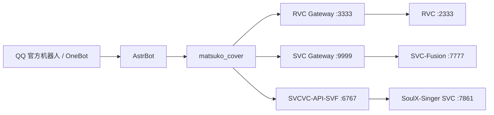

# astrbot_plugin_chorus_cover（副歌翻唱 · 自维护分支）

## 取歌方式

取歌/下载实现与点歌插件 `astrbot_plugin_music` 一致：

- **主路**：meting 公开接口拿直链，不需要 cookie，也不需要本地服务。
- **备用路**：本地 NeteaseCloudMusicApi 服务，会员歌靠它 + `netease_cookie` 拿整首。
  - 启动（可选）：`powershell -ExecutionPolicy Bypass -File D:\PYMSS-RVC\netease-api\start.ps1`
  - 把 `netease_api_base` 指到它实际监听的端口（本机 3000/3001 被 SnowLuma 占用，服务实际在 **3003**）
- 两条路都过同一条 80 秒时长闸门，拿不到整首按失败处理。

## 这是自维护分支

- **来源**：本仓库是 [sdfsfsk/matsuko_cover](https://github.com/sdfsfsk/matsuko_cover)（`astrbot_plugin_matsuko_cover`）**v2.13.0** 的自维护分支，维护者 void-HaoNan，仓库地址 <https://github.com/void-HaoNan/astrbot-plugin-chorus-cover>。
- **许可证**：与上游一致，**GNU AGPL-3.0**；`LICENSE` 保持上游原样未改。上游版权归原作者所有，修改声明见 [NOTICE.md](NOTICE.md)，变更明细见 [CHANGELOG.md](CHANGELOG.md)。
- **与上游 v2.13.0 的差异**：
  1. 统一对话出口 `outbound.py`：进度提示、风控重试提示、报错详情三类文本统一交给人格模型说一句人话。
  2. 进度提示与重试提示**默认静音**（`notify_progress` / `notify_retry` 缺省 `false`）。
  3. 失败**只发一句话**：重试次数、错误码、后端返回等技术细节只写日志。
  4. 失败判断使用明确标记（`❌` / `FAIL:` 开头）。
  5. 修复 QQ 音乐 mid 解析（新版返回结构里 mid 已是字符串导致的 `'str' object has no attribute 'mid'`）。
  6. 备选音源接口使用当前已失效者之外的可用实现。
  7. 音源只有网易云：搜歌与取歌都走网易云，取不到整首直接失败。
  8. 取歌/下载实现与点歌插件 `astrbot_plugin_music` 一致（meting 直链 → 下载 → 落盘命名/失败清理同一套）。
- **维护方式**：**本分支不再跟随上游更新**，只按自己需要打补丁；上游的新功能不会自动合并进来。想要上游版本请直接使用上游仓库。

---

适用于 [AstrBot](https://github.com/AstrBotDevs/AstrBot) 的 AI 翻唱插件，支持 **RVC、SVC-Fusion、SoulX-SVCVC** 三种语音转换后端，以及网易云音乐、本地音频和 LLM 工具调用（QQ 音源已于 0.3.0 下线）。

> 当前版本：**v0.6.0**（自维护分支，基线为上游 v2.13.0）
>
> 许可证：**GNU AGPL-3.0**
>
> 本项目基于 [sdfsfsk/matsuko_cover](https://github.com/sdfsfsk/matsuko_cover) v2.13.0，上游又基于 [CCYellowStar2/astrbot_plugin_rvc_svc](https://github.com/CCYellowStar2/astrbot_plugin_rvc_svc) 扩展。

## 功能

| 功能 | RVC | SVC-Fusion | SoulX-SVCVC |
|---|:---:|:---:|:---:|
| 网易云点歌（唯一音源） | ✅ | ✅ | ✅ |
| 本地音频翻唱 | ✅ | ✅ | ✅ |
| LLM 智能点歌 | ✅ | ✅ | ✅ |
| 模型/音色列表和别名 | ✅ | ✅ | ✅ |
| 自动升降调 | ✅ | ✅ | ✅ |
| 推理进度发送到 QQ | ✅ | ✅ | ✅ |
| 参数级结果缓存 | 由中间层提供 | 由中间层提供 | ✅ |
| 零样本参考音色 | ❌ | ❌ | ✅ |
| 固定/随机种子 | ❌ | ❌ | ✅ |

其他能力：

- 搜索、选歌、选模型、推理和发送结果的完整工作流。
- 自动识别 QQ 官方机器人，使用原生按钮选歌、选音色、翻页和取消；按钮不可用时发送完整文字菜单。
- RVC/SVC 的 F0、检索率、混响、延迟、人声/伴奏音量等参数。
- MSST 模型列表、默认分离模型切换和分离质量参数。
- 翻唱任务查询、取消、批量翻唱、用户偏好和统计。
- `/查看翻唱缓存 [all|rvc|svc|svcvc]` 查看各后端缓存占用；管理员可用 `/清理翻唱缓存 [...]` 安全清理。
- 取消任务会同步取消插件协程和 Gradio 推理任务，不再只隐藏任务状态。
- QQ 语音发送失败时自动继续尝试发送音频文件。
- 默认关闭旧版 EQ/压缩/混响人声后处理，避免重复处理损伤音质；需要旧音色时可开启 `vocal_postprocess`。
- **点歌 / 翻唱分开判定**：所有翻唱入口先过 `intent_gate.py` 的统一闸门，点歌类消息不会被翻唱接走（见 [点歌和翻唱怎么分](#点歌和翻唱怎么分)）。

## 唱多长：三种翻唱模式（0.6.0 新增）

在插件配置里用 `render_mode` 选，默认 `chorus`：

| 模式 | 唱多长 | 后端怎么处理 | 实测（4:39 的歌） |
| --- | --- | --- | --- |
| `chorus`（默认） | 副歌片段，默认 45 秒 | 先切 60 秒去分离，再在人声里精挑 45 秒 | **32.6 秒** 出成品（HTTP 端到端 34.1 秒） |
| `custom` | 自定义 20~180 秒（`chorus_seconds`） | 先切「时长 + 15 秒」去分离，再精挑 | `chorus_seconds=30` → **27.1 秒**（端到端 27.9 秒） |
| `full` | 整首 | 分离整首、变声整首，不做副歌挑选 | 100 秒素材 **52.7 秒**；三四分钟的歌要几分钟以上 |

**完整翻唱（`full`）耗时明显更长，可能是副歌模式的 5~10 倍，显存占用也更高。**
它不是「45 秒换成 279 秒」的线性放大：分离和变声的耗时都随长度涨，长音频还会把显存吃到接近上限后降速。
要整首翻唱，请同时把 `inference_timeout`（默认 300 秒）和 `task_timeout_seconds` 调大，并确认显卡扛得住。

`chorus` / `custom` 的省时来自中间层 0.7.0：先在整首混音上挑候选窗口，**只分离那 60 秒左右**，
不再整首过分离模型；同一首歌改前 72.2 秒、改后 32.6 秒。本插件会自动探测后端是否支持 `render_mode`
（老版本中间层没有这个参数就整组不传，按副歌模式走），所以升级中间层前后都能用。
SVC / SoulX-SVCVC 后端没有这组参数，插件自动跳过。

> 换 `render_mode` 或 `chorus_seconds` 会换缓存 key，同一首歌不同模式不会互相命中。

## 架构



插件负责聊天交互、歌曲搜索/下载、参数选择和结果发送；中间层负责人声分离、缓存、后处理及调用实际推理引擎。

## 安装

将仓库克隆到 AstrBot 的插件目录：

```bash
cd AstrBot/data/plugins
git clone https://github.com/sdfsfsk/matsuko_cover.git astrbot_plugin_matsuko_cover
pip install -r astrbot_plugin_matsuko_cover/requirements.txt
```

随后重启 AstrBot，并在 WebUI 的插件配置中启用需要的后端。

依赖：

```text
gradio_client
aiohttp
```

## QQ 官方机器人交互

在 WebUI 的本插件配置中，默认开启 **“自动识别 QQ 官方机器人并使用 Markdown 卡片”**（`qq_official_cards=true`）与 **“自动识别 QQ 官方机器人并启用交互按钮”**（`qq_official_buttons=true`）。插件根据 `qq_official` / `qq_official_webhook` 自动选择官方消息协议，不需要另填 AppID 或密钥。

根据官方 [Markdown 消息文档](https://bot.q.qq.com/wiki/develop/api-v2/server-inter/message/type/markdown.html) 的 2026-04-23 更新，**QQ群和单聊已开放自定义 Markdown，无需单独申请模板**；频道场景仍需账号开通对应能力。卡片使用标题、加粗序号、分隔线和状态字段，歌曲名与模型名会单独转义，避免特殊字符破坏布局。

使用 `/rvc`、`/svc`、`/svcvc` 点歌时（0.3.0 起只有网易云一个音源）：

1. 机器人在一条消息中展示歌曲列表、选择按钮和操作说明。
2. 选歌后展示模型/参考音色列表及对应按钮。
3. 选定音色后，使用原有后端执行翻唱并发送结果。

每页显示 8 个选项，超过一页时可用 **上一页 / 下一页** 按钮浏览，也可直接发送全局序号；**取消**按钮或文字“取消”会结束当前选择。每次翻页后重新开始配置的选择等待时间（`timeout`）。

回调按钮点击后直接执行选择，不会向聊天框填入指令，也不需要再发送确认。手动输入序号仍兼容当前会话的唤醒前缀，例如 `#1`。

| 场景 | 按钮行为 |
|---|---|
| QQ 官方机器人单聊 | 点击回调按钮直接选择，无需发送消息 |
| QQ 官方机器人群聊/频道 | 点击回调按钮直接选择；手动输入序号时通常需要 @机器人 |
| 旧 WebSocket 连接尚未订阅回调 | 保留卡片，临时使用自动发送指令按钮，点击后无需手动确认 |
| 关闭按钮开关，或按钮请求失败 | 保留 Markdown 卡片，通过序号、上一页、下一页、取消继续操作 |
| 关闭卡片开关，或 Markdown 请求失败 | 发送完整的文字菜单 |
| OneBot（aiocqhttp） | 保留合并转发菜单，并支持相同的文字选择操作 |

选择菜单优先使用官方的**回调按钮**（`action.type=1`），通过 SDK 的 `INTERACTION_CREATE` 事件处理点击。收到点击后先调用互动响应接口确认，再执行选择或翻页，避免客户端一直等待。按钮权限限定为点歌者，插件同时校验会话、用户和本次菜单标识；旧菜单按钮不会误选到新一轮歌曲或音色。

旧连接尚未订阅互动事件时，菜单临时使用 `action.type=2`、`enter=true` 的指令按钮，QQ 客户端自动发送带本次菜单标识的选择命令。它会产生一条聊天消息，但无需再点发送确认；不支持自动发送的旧客户端仍可手动输入序号。该行为依据官方[发送单聊消息的 Action 字段](https://bot.q.qq.com/wiki/develop/api-v2/autogen/api/v2_users_user_openid_messages.post.html)。

可使用以下卡片入口：

| 入口 | 展示内容 |
|---|---|
| `/翻唱帮助` | 翻唱用法，以及音色刷新、任务、统计快捷按钮 |
| `/rvc`、`/svc`、`/svcvc` | 无参数时展示用法卡片；点歌时展示歌曲选择、音色选择和开始翻唱卡片 |
| `/刷新rvc模型`、`/刷新svc模型`、`/刷新svcvc音色` | 音色列表卡片 |
| `/列出msst模型`、`/列出svcvc分离模型` | 分离模型列表卡片；管理员切换成功后也显示结果卡片 |
| `/查看翻唱缓存`、`/清理翻唱缓存` | 缓存统计或清理结果卡片，保留原有管理员权限 |
| `/查看翻唱任务`、`/取消翻唱任务`、`/我的翻唱统计` | 状态、取消结果或个人统计卡片 |
| 本地音频翻唱 | 开始处理与完成结果卡片 |

帮助与任务卡片中的快捷按钮属于自动发送指令按钮，命令仍经过 AstrBot 的权限和插件开关检查。音频结果仍通过原有语音/文件通道发送。按钮发送失败时先重试无按钮卡片，Markdown 也失败时再发送文字，避免列表消失。

原生按钮能否展示取决于机器人账号具备的消息能力及 QQ 客户端版本。插件不会把按钮请求失败当成发送成功，而会显示文字菜单供继续操作。参考官方[消息发送与键盘字段](https://bot.q.qq.com/wiki/develop/api-v2/autogen/api/v2_users_user_openid_messages.post.html)和[消息交互说明](https://bot.q.qq.com/wiki/develop/api-v2/server-inter/message/trans/overview.html)。

**要使用不产生聊天消息的回调选择，升级后请重启一次 QQ 官方机器人平台连接或 AstrBot**：插件需要在连接建立前增加 `INTERACTION (1<<26)` 订阅，仅重载插件不能让已建立的旧连接新增订阅。v2.13.0 起，尚未重连也可以看到卡片，并使用自动发送按钮继续选择。Webhook 模式还需在 QQ 开发者后台订阅互动事件。

回调接收逻辑由插件绑定到 QQ SDK 实例，无需改动 AstrBot 框架或第三方依赖。插件卸载时恢复已有事件处理函数；其他插件的回调事件继续交给原处理函数。

插件会区分互动确认用的 `d.id` 与发送后续消息用的 `event_id`，不把点击事件伪装成用户消息 ID。回调回复使用独立的 SDK 包装，不修改共享客户端的普通消息请求。重复事件仅确认、处理一次；其他用户、跨群/跨机器人点击以及过期按钮会被拒绝。

重启后请重新发起点歌，旧版菜单不能继续使用。

## 后端准备

### 中间层源码下载

旧版 README 中的百度网盘整合包不再作为主要下载入口，请直接使用以下公开项目：

| 项目 | 中间层端口 | 上游依赖 | 人声分离 | 适合场景 |
|---|---:|---|---|---|
| [RVCSVC-API-amd](https://github.com/sdfsfsk/RVCSVC-API-amd) | `3333` / `9999` | RVC `2333` / SVC-Fusion `7777` | UVR5 / HP5 | 环境较轻、兼容范围较广 |
| [RVCSVC-API-MSST](https://github.com/sdfsfsk/RVCSVC-API-MSST) | `3333` / `9999` | RVC `2333` / SVC-Fusion `7777` | BS-Roformer / MSST | 更高分离质量、显存需求更高 |
| [SVCVC-API-SVF](https://github.com/sdfsfsk/SVCVC-API-SVF) | `6767` | SoulX-Singer SVC `7861` | SoulX / 内置 MSST / 不分离 | 零样本参考音色转换 |

> [!CAUTION]
> **完整推理方案仅支持 Windows AMD 显卡（A 卡），NVIDIA、Intel GPU 和纯 CPU 环境不在支持范围内。** `RVCSVC-API-amd` 与 `RVCSVC-API-MSST` 使用相同的 3333/9999 端口，只需选择其中一个，不能同时启动；`SVCVC-API-SVF` 使用 6767 端口，可以与前两者之一同时运行，但还需要应用 AMD 补丁的 SoulX-Singer 上游。

公开仓库只包含源码和环境安装脚本，不包含已安装的 Python/ROCm 运行时、UVR5/MSST 权重、RVC/SVC/SoulX 模型、私人参考音色或歌曲缓存。请按照各项目 README 准备环境、上游引擎和分离模型；SVCVC 的内置 MSST 权重下载链接、SHA-256 和放置路径已写在 [SVCVC-API-SVF README](https://github.com/sdfsfsk/SVCVC-API-SVF#msst-模型下载)。

### RVC

- 插件默认中间层：`http://127.0.0.1:3333/`
- 从 [RVCSVC-API-amd](https://github.com/sdfsfsk/RVCSVC-API-amd) 或 [RVCSVC-API-MSST](https://github.com/sdfsfsk/RVCSVC-API-MSST) 选择一个中间层。
- 启动 RVC 上游和所选中间层。
- 使用 `/刷新rvc模型` 读取模型列表。

### SVC-Fusion

- 插件默认中间层：`http://127.0.0.1:9999/`
- 从 [RVCSVC-API-amd](https://github.com/sdfsfsk/RVCSVC-API-amd) 或 [RVCSVC-API-MSST](https://github.com/sdfsfsk/RVCSVC-API-MSST) 选择一个中间层。
- 启动 SVC-Fusion 上游和所选中间层。
- 兼容补丁参考：[sdfsfsk/SVC-Fusion-fix](https://github.com/sdfsfsk/SVC-Fusion-fix)
- 使用 `/刷新svc模型` 读取模型列表。

### SoulX-SVCVC

SoulX-SVCVC 使用参考音频进行零样本音色转换，不需要训练 `.pth` 音色模型。

- 中间层：[sdfsfsk/SVCVC-API-SVF](https://github.com/sdfsfsk/SVCVC-API-SVF)
- Windows AMD ROCm 补丁：[sdfsfsk/SoulX-Singer-AMD-Patch](https://github.com/sdfsfsk/SoulX-Singer-AMD-Patch)
- 插件默认中间层：`http://127.0.0.1:6767/`
- SoulX-Singer SVC 上游：`http://127.0.0.1:7861/`
- 目标歌曲分离：`soulx`（默认、由上游分离）、`msst`（中间层内置 BS-Roformer）或 `none`（直接交给 SoulX）。
- `msst` 模式需要完整的 `SVCVC-API-SVF/runtime-rocm/` 和模型权重；下载后无需依赖相邻的 `RVCSVC-API-MSST` 目录。

启动顺序：

1. 启动 SoulX-Singer，选择 `SVC voice conversion`，等待 7861 就绪。
2. 启动 SVCVC-API-SVF，等待 6767 就绪。
3. 在插件配置中开启 `enable_svcvc`。
4. 使用 `/刷新svcvc音色`。

若选择 `msst` 并开启“自动混回伴奏”，请使用带 `soulx_svc_convert_external_acc_path` 接口的 AMD 补丁版 SoulX-Singer；中间层会在分离前检查该接口，缺失时会立即提示而不浪费整首歌的分离时间。

参考音色放入 SVCVC-API-SVF 的 `voice_profiles/`。支持 WAV、FLAC、MP3、OGG、M4A 和 AAC；文件名默认作为音色 ID，也可添加同名 JSON：

```json
{
  "profile_id": "my_voice",
  "display_name": "示例音色",
  "description": "干净、无伴奏的参考演唱",
  "prompt_vocal_sep": false
}
```

建议使用 5～30 秒、单人、无伴奏、低混响的干净音频。新增音色后需要重启或刷新中间层的 Gradio 音色选项，再执行插件刷新命令。

## 常用配置

| 配置 | 默认值 | 说明 |
|---|---:|---|
| `rvc_base_url` | `http://127.0.0.1:3333/` | RVC 中间层 |
| `svc_base_url` | `http://127.0.0.1:9999/` | SVC-Fusion 中间层 |
| `svcvc_base_url` | `http://127.0.0.1:6767/` | SoulX-SVCVC 中间层 |
| `enable_rvc` | `true` | 启用 RVC |
| `rvc_default_model` | 空 | 下拉选择默认 RVC 音色模型（8 个固定选项）；留空则沿用 `default_model_index` 序号 |
| `enable_svc` | `true` | 启用 SVC-Fusion |
| `enable_svcvc` | `false` | 启用 SoulX-SVCVC |
| `enable_qqmusic` | `false` | 保留只为兼容旧配置 |
| `disable_netease` | `false` | 已无效（只剩网易云一条路，开启也按网易云继续） |
| `disable_qqmusic` | `true` | 已锁死只用网易云 |
| `netease_cookie` | 空 | 网易云 `MUSIC_U` 值；主路（meting）不吃 cookie，会员歌要靠备用服务带上它；只存本机 |
| `netease_quality` | `320` | 网易云取歌音质，只支持 `128` / `192` / `320` |
| `netease_meting_base` | `https://api.qijieya.cn/meting/` | 取直链主路（照搬点歌插件），不需要密钥；服务挂了可换自建 meting |
| `netease_api_base` | `https://zm.wwoyun.cn` | 取直链备用路（点歌插件的 NodeJS API）；本机服务在跑就填 `http://127.0.0.1:3003`，留空则该备用路不用 |
| `netease_api_token` | 空 | 备用服务需要鉴权时填（`Authorization: Bearer <令牌>`） |
| `alert_admin_on_cookie_expired` | `true` | cookie 连续失效时提醒管理员 |
| `cookie_alert_interval_hours` | `6` | 同一失效状态的最小提醒间隔（小时） |
| `enable_progress_bar` | `true` | 将后端进度发到聊天 |
| `notify_progress` | `false` | 发送翻唱进度提示（自维护分支新增；打开后也只由人格模型说一句） |
| `notify_retry` | `false` | 发送风控自动重试提示（自维护分支新增；默认不打扰用户） |
| `progress_update_interval` | `3` | 进度消息最小间隔（秒） |
| `enable_send_file` | `false` | 除 QQ 语音外再发送文件 |
| `inference_timeout` | `300` | 推理超时（秒）；选 `render_mode=full`（整首翻唱）时要调大 |
| `render_mode` | `chorus` | 唱多长：`chorus` 副歌片段（默认，最快）/ `custom` 自定义 / `full` 整首（耗时可能是副歌的 5~10 倍，显存占用更高）。需要 `chorus-mw` 0.7.0+ |
| `chorus_seconds` | `45` | 翻唱时长（秒），范围 20~180；`custom` 按它定长，`chorus` 也用它当片段长度 |
| `llm_force_mode` | `false` | 禁用手动命令，只允许 LLM 工具 |
| `local_audio_trigger_keywords` | `["翻唱", "变声"]` | 本地音频自动触发词。默认只留明确想唱的词；「转换」「处理」「修音」这类泛词会把点歌和闲聊也吞进来，已从默认值去掉 |
| `local_audio_auto_trigger` | `false` | 是否自动翻唱带音频的消息。默认关闭，避免和点歌抢活；关闭后仍可用 `/本地翻唱` 或 LLM 工具 |

SoulX 在 AMD 上处理长歌曲时建议把 `inference_timeout` 和任务超时提高到 `9000` 秒。

### 网易云取歌（0.5.0 起照搬点歌插件）

网易云点歌不再把歌曲 id 直接丢给中间层（中间层不认 id），而是插件先下载成整首音频文件，再把本地路径交给中间层。取歌/下载这层**整套照搬点歌插件 `astrbot_plugin_music`**，落在 `netease_fetch.py`（只保留取直链 + 下载，去掉发卡片/发语音/歌词评论等无关逻辑）。

**① 主路：meting 取直链（点歌插件 `netease` 平台那套，不吃 cookie）**

1. `GET {netease_meting_base}?type=song&id=<id>`（默认 `https://api.qijieya.cn/meting/`），返回 `[{name, artist, url, pic, lrc}]`。
2. 其中的 `url` 就是可直接下载的跳转地址（会 302 到带时间签名的 `m701.music.126.net` CDN），插件跟着跳转流式下载。
3. 搜歌也走点歌插件同一个接口：`POST http://music.163.com/api/search/get/web`，参数 `s` / `limit` / `type=1` / `offset=0`，带 `appver=2.0.2`。

**② 备用路：NodeJS 网易云 API（点歌插件 `netease_api` 平台那套）**

1. 主路拿不到直链（或只给试听）时才用它，地址是 `netease_api_base`（默认点歌插件的 `https://zm.wwoyun.cn`；本机起了服务就填 `http://127.0.0.1:3003`）。
2. 先试 `GET {base}/song/url/v1?id=<id>&level=exhigh&cookie=MUSIC_U%3D<值>`（带 cookie 能换到可下会员歌的签名直链），不行再退回点歌插件原版的 `GET {base}/song/url?id=<id>`。
3. `level` 由 `netease_quality` 决定：`320`→`exhigh`、`192`→`higher`、`128`→`standard`。

**落盘与清理（同样照搬点歌插件）**

- 下载目录是插件自己的 `temp_audio/`，文件名 `uuid4().hex` + 后缀（后缀按 URL 路径的白名单判断，认不出就 `.mp3`）。
- 1024 字节一片流式写入；HTTP 非 200、返回的是错误页/JSON、超过 60MB、连接被掐断（写入字节数少于 `Content-Length`），一律删掉半截文件并判失败。
- 任务结束（成功或失败）由 `_prepare_song_audio` 的调用方按 `temp_audio/` 前缀清理，不留给下一次。

**本插件自己保留的一条保护：80 秒闸门**

下载完统一用 `ffprobe` 量真实时长，不足 80000ms 的删文件判失败（原因写"下载到的不是整首（时长 xx 秒）"）；量不到时长也按失败处理。点歌插件没有这道闸门（它只把试听写进卡片备注），这里保留，绝不把试听片段交给中间层。

**统一取歌顺序**（卡片选歌、命令点歌、LLM 工具、批量翻唱全部共用 `_prepare_song_audio`，任何入口都只把本地音频交给中间层）：本地文件直通 → 纯数字按网易云 id（主路 meting → 备用路 NodeJS）→ 11~14 位字母数字的旧 QQ mid（不再碰任何 QQ 音源，直接按歌名去网易云搜，搜不到就失败）→ 其它当歌名（先搜网易云拿数字 id，再回上一步）；每一步下完都过 80 秒闸门，失败原因串成一句中文。

**cookie 失效提醒**：连续 3 次取歌都因为"只给试听 / HTTP 401 / code 不对"失败时，私聊 AstrBot 全局配置里的 `admins_id` 提醒更新 cookie；找不到管理员就发回触发点歌的会话。同一失效状态按 `cookie_alert_interval_hours` 去重，取歌成功后状态清空。

> 整首闸门依赖本机 `ffprobe`（通常随 `ffmpeg` 一起安装）。没有 `ffprobe` 时一律按"无法确认是整首"失败，不会把可疑片段交给中间层。

### SoulX 参数

| 配置 | 默认值 | 说明 |
|---|---:|---|
| `svcvc_prompt_vocal_sep` | `false` | 是否分离参考音频 |
| `svcvc_target_separation` | `soulx` | 目标分离方式：`soulx` / `msst` / `none` |
| `svcvc_auto_shift` | `true` | 自动匹配音域 |
| `svcvc_auto_mix_acc` | `true` | 自动混回伴奏 |
| `svcvc_pitch_shift` | `0` | 指定变调，范围 -36～36 |
| `svcvc_n_step` | `32` | 采样步数，越高通常越慢 |
| `svcvc_cfg` | `1.0` | CFG 系数 |
| `svcvc_seed` | `42` | 固定种子（0–4294967295） |
| `svcvc_random_seed` | `false` | 每次使用随机种子 |

固定种子且其他参数一致时可以命中持久缓存；开启随机种子后，SVCVC-API-SVF 默认不会读取或写入持久缓存。

## 命令

### 模型和后端

| 命令 | 说明 |
|---|---|
| `/刷新rvc模型` | 刷新 RVC 模型 |
| `/刷新svc模型` | 刷新 SVC-Fusion 模型 |
| `/刷新svcvc音色` | 刷新 SoulX 参考音色 |
| `/列出msst模型` | 查看 MSST 分离模型 |
| `/切换msst模型 <序号或名称>` | 切换 MSST 分离模型 |
| `/列出svcvc分离模型` | 查看 SVCVC-API-SVF 内置的 MSST 分离模型及当前选择 |
| `/切换svcvc分离模型 <序号或名称>` | 切换并持久化 SVCVC-API-SVF 的 MSST 分离模型（管理员） |
| `/设置rvc后端链接 <URL>` | 修改 RVC 中间层地址（管理员） |
| `/设置svc后端链接 <URL>` | 修改 SVC 中间层地址（管理员） |
| `/设置svcvc后端链接 <URL>` | 修改 SVCVC 中间层地址（管理员） |

### 点歌

| 命令 | 说明 |
|---|---|
| `/rvc <歌名> [升降调]` | RVC + 网易云点歌 |
| `/svc <歌名> [升降调]` | SVC-Fusion + 网易云点歌 |
| `/svcvc <歌名> [升降调]` | SoulX-SVCVC + 网易云点歌 |
| `/qqrvc` 等 QQ 入口 | 当前版本不提供 |
| `/本地翻唱` | 使用最近上传/缓存的本地音频 |

### 任务

| 命令 | 说明 |
|---|---|
| `/查看翻唱任务` | 查看当前任务状态 |
| `/取消翻唱任务` | 请求取消当前任务 |
| `/我的翻唱统计` | 查看个人翻唱统计 |

如果启用了 `llm_force_mode`，上述手动命令会被禁用，请直接通过自然语言要求机器人点歌。

## LLM 工具

插件提供以下主要 Function Calling 工具：

- `search_music`：搜索网易云音乐。
- `rvc_cover`：使用 RVC 翻唱。
- `svc_cover`：使用 SVC-Fusion 翻唱。
- `svcvc_cover`：使用 SoulX 参考音色翻唱。
- `smart_cover`：自动完成搜索、选歌、模型匹配和翻唱。
- `batch_cover`：批量翻唱。
- `get_available_models`：读取三种引擎的模型/音色列表。
- `cover_absolute_path_audio`：处理本地绝对路径音频。
- `cover_local_audio`：处理用户上传的音频。
- `get_task_status` / `cancel_cover_task`：查询或取消任务。

示例：

```text
用甘城喵音色从网易云翻唱《起风了》
用 RVC 第 2 个模型翻唱《晴天》，升 2 调
列出现在可用的 SoulX 参考音色
```

### 点歌和翻唱怎么分

翻唱插件的每个执行入口（`smart_cover`、`rvc_cover`、`svc_cover`、`svcvc_cover`、`batch_cover`、
`cover_absolute_path_audio`、`cover_local_audio`，以及本地音频自动触发）都会先过一道统一闸门
（`intent_gate.py`）：

- 消息里出现点歌类词（`点歌`、`放歌`、`听歌`、`来一首`、`放一首`、`播一首`，以及「放首歌」这类
  省略写法），并且**没有**翻唱类词（`唱`、`翻唱`、`翻唱成`、`变声`、`cover`、`用…唱`）
  → 判定为点歌需求：不注册任务、不执行翻唱，只把「这是点歌需求」这句事实回给模型，由模型引导
  用户用「点歌 歌名」，或直接调用点歌插件的 `play_song_by_name` 工具。
- 只要出现翻唱类词就放行：「唱晴天」「翻唱一下晴天」「用三月七唱晴天」「变声」都照常翻唱。

词表集中在 `intent_gate.py` 的 `TICKET_WORDS_MUSIC` / `TICKET_WORDS_COVER` 两个常量，以后加词只改那里。

## 进度、缓存和结果发送

- 支持接收 Gradio 的下载、人声分离、F0、逐段推理、混音和导出进度。
- `progress_update_interval` 控制聊天提示频率，避免刷屏。
- 中间层返回 `cache_hit` 时，插件会提示缓存命中并直接发送结果。
- 默认先发送 QQ 语音；语音发送失败时无论 `enable_send_file` 是否开启都会继续发送音频文件，避免结果丢失。
- 网易云由插件先下载成整首文件，再提交给中间层；用官方接口判定、外链入口下载（`MUSIC_U` cookie），试听片段会被过滤掉。0.3.0 起没有任何备用音源。

## 常见问题

### 无法连接后端

确认对应端口正在监听，并检查插件配置中的 URL。SVCVC 必须先启动 SoulX 7861，再启动中间层 6767。

### 新增 SVCVC 音色后转换提示“不在 choices 中”

请升级 SVCVC-API-SVF v1.2.0 或更高版本，再执行 `/刷新svcvc音色`。新版下拉框允许动态音色 ID，并提供 WebUI 刷新按钮，无需重启。

### SoulX 推理完成但机器人没有收到文件

请使用带 `/soulx_svc_convert_path` 接口的 AMD 补丁和最新版 SVCVC-API-SVF；该接口避免在同一台机器上通过 Gradio 重复下载大型 WAV。

### QQ 音乐的入口和配置怎么没了

QQ 入口说明：`/qqrvc` 等命令不再提供，`enable_qqmusic`、`disable_qqmusic`、`third_party_api_key` 等配置保留只为兼容旧配置，不再影响取歌。所有点歌一律走网易云。

### 网易云提示“拿不到整首歌”

先看日志里的失败原因：主路 `netease_meting_base`（默认 `https://api.qijieya.cn/meting/`）能不能访问、备用服务 `netease_api_base` 是否活着（`netstat -ano | findstr :3003`，或看 `D:\PYMSS-RVC\netease-api\logs\server.log`）、`netease_quality` 是否为 `128` / `192` / `320`、本机有没有 `ffprobe`。插件只接受“整首”（≥ 80 秒），试听片段会被直接判失败。会员歌（`fee=1`）要靠备用服务带上 `netease_cookie` 才下得到；主路 meting 不吃 cookie，拿到的多是免费音质。

### 本地取歌服务起不来 / 端口冲突

0.5.0 起本地服务是**可选**的，不起也能取歌。要用它下会员歌时：`3000`、`3001` 在本机已经被 SnowLuma 占用，服务会自动换到 `3003`。起服务用 `D:\PYMSS-RVC\netease-api\start.ps1`，然后把插件配置 `netease_api_base` 改成实际端口；`start.ps1` 里的 `$Port` 也可以改。

### SoulX 无法命中缓存

检查 `svcvc_random_seed` 是否关闭。歌曲内容、参考音色、种子、采样步数、CFG、升降调或模型资产变化都会生成新的缓存键。

## 更新日志

### v0.6.0（本分支）

- 新增「唱多长」配置：`render_mode`（`chorus` 默认 / `custom` / `full`）与 `chorus_seconds`（20~180，默认 45）。
  `full` 是整首翻唱，耗时可能是副歌模式的 5~10 倍、显存占用更高，需要同时调大 `inference_timeout`。
- 时长参数按后端 `/convert` 参数名探测，老中间层没有 `render_mode` 就整组不传并记一条 warning，不会报 invalid keyword。
- 配套 `chorus-mw` 0.7.0：先切 60 秒再分离、常驻 worker、去混响与伴奏处理并行；同一首 4:39 的歌 72.2 秒 → 32.6 秒。

### v0.5.0（本分支）

- **取歌/下载实现整套照搬点歌插件 `astrbot_plugin_music`**：新增 `netease_fetch.py`，把点歌插件的 `core/platform/netease.py`（搜歌 + meting 直链）、`netease_api.py`（NodeJS API）、`core/platform/base.py`（请求解析 + 流式下载）里跟"取直链 + 下载"有关的部分搬过来，去掉发卡片/发语音/歌词评论等无关逻辑；删掉原来自己写的 `netease.py`（官方接口判定 + 外链兜底那套）。
- 取歌顺序变为：meting 直链（不吃 cookie）→ NodeJS 服务直链（带 cookie 可下会员歌），下载仍落在 `temp_audio/`，命名/失败清理与点歌插件一致。
- `_prepare_song_audio` 对外契约不变：仍返回 `(本地路径 | None, 失败原因, 是否试听)`，仍过 80 秒 `ffprobe` 闸门。
- 删除启动/取歌时几条说明性日志横幅：「QQ 音源已下线：搜歌与取歌只走网易云官方接口」「网易云取歌首选本地服务: …」「没配置 netease_api_base，网易云取歌只走官方接口 + 外链方式」，以及按音源打印的「音乐源 xxx 已下线…」。正常 `[取歌]` 日志和错误日志全部保留。
- 配置项只增不减：新增 `netease_meting_base`（主路地址）、`netease_api_token`（备用服务可选鉴权）；`netease_api_base` 默认值改为点歌插件用的 `https://zm.wwoyun.cn`；`netease_cookie` / `netease_quality` 继续有效。

### v0.4.3（本分支）

- 新增统一需求闸门 `intent_gate.py`：`TICKET_WORDS_MUSIC` / `TICKET_WORDS_COVER` 两个词表集中管理判定；点歌类消息（含「嗯。点歌。失眠飞行。」这种不按命令格式发的）不会再被 `smart_cover` 等翻唱入口接走。
- 闸门接入 `smart_cover`、`rvc_cover`、`svc_cover`、`svcvc_cover`、`batch_cover`、`cover_absolute_path_audio`、`cover_local_audio` 和本地音频自动触发；命中后只回事实给模型，不执行翻唱。
- `local_audio_trigger_keywords` 默认收窄为 `["翻唱", "变声"]`；`local_audio_auto_trigger` 默认改为 `false`，不再主动抢带音频的消息。
- 同步线上已有的 `_pick_best_song`（搜歌只接受歌名/歌手能对上的结果，宁可不选也不选错），仓库与线上保持一致。

### v0.4.0（本分支）

- 新增取歌路径 `netease.download_by_api_service()`：调本地 NeteaseCloudMusicApi 的 `/song/url/v1` 换带时间签名的 CDN 直链后下载，**能下会员歌**；失败再回落原来的官方接口 + 外链方式。
- 新增配置项 `netease_api_base`（默认 `http://127.0.0.1:3000`），指向本地服务；留空则只用外链方式。
- 两条路共用同一套整首闸门（接口五条判定 + `ffprobe` 80 秒），会员歌不再因为官方接口只给试听/HTML 就直接失败。
- 实测：`657666` 245.9 秒、`536622304` 256.0 秒、`2652820720` 279.0 秒，均 320k 整首。

### v0.3.1（本分支）

- 新增配置项 `rvc_default_model`：在 WebUI 插件设置里用下拉框直接选默认 RVC 音色（固定 8 个模型），不用再记 `default_model_index` 是第几个。
- 优先级：用户显式指定的模型名/序号 > `rvc_default_model` > 用户偏好/`default_model_index`；下拉选的模型不在当前列表里时回落到序号逻辑，并记一条 warning。仅对 RVC 生效，SVC/SoulX 不受影响。

### v0.3.0（本分支）

- 移除洛雪（LX-Source）兜底：删除洛雪下载与地址拼接函数，以及洛雪地址、认证头、兜底开关三项配置。
- 只用网易云官方接口 + `MUSIC_U` cookie 取整首；QQ 音源下线，搜歌阶段不再使用 QQ，`/qqrvc` 等 QQ 入口不再提供。
- 旧的 QQ mid 输入改为“按歌名去网易云搜”，搜不到直接失败。

### v2.10.4

- 修复插件配置中的 MSST 模型、Batch Size、Num Overlap、Normalize 和 TTA 未传入 SVCVC-API-SVF 的问题。
- SVCVC 使用 MSST 目标分离时会按任务提交这些参数；旧版中间层会自动回退到后端配置，不会因多传参数而报错。
- `/切换svcvc分离模型` 会同步更新插件默认模型，且不同 MSST 参数使用独立分离/结果缓存。

### v2.10.3

- 修复 LLBot `upload_group_file` 已上传二进制、但群文件动态发布返回 `code=-1002` 时被误判为完全失败的问题。
- 上传异常后会查询群文件列表核对文件名、大小和时间；确认文件已存在时停止重复上传，并尝试获取群文件直链作为兜底提示。

### v2.10.2

- 针对 LLBot 的 `upload_group_file` 临时性 `code=-1002 / 请重试`：语音发送后延迟上传，并按退避间隔重试三次。
- 最后一次重试自动使用纯 ASCII 文件名，排除协议端文件名编码兼容问题；日志会记录每次回执，全部失败时在 QQ 明确提示。

### v2.10.1

- SVCVC-API-SVF 的 MSST 子进程百分比可经 Gradio 进度事件实时输出到 QQ，并继续受 `progress_update_interval` 节流控制。
- QQ 群聊启用“同时发送文件”时优先调用 OneBot `upload_group_file`，避免普通 `File` 消息被协议端静默忽略；失败时仍回退原文件消息。

### v2.10.0

- 新增 `/列出svcvc分离模型` 与管理员 `/切换svcvc分离模型`，直接管理 SVCVC-API-SVF 内置 MSST 模型。
- 模型切换由中间层写回 `config.json`，重启后继续生效，分离缓存按模型指纹自动隔离。
- SVCVC 的 MSST 自动混伴奏任务会在分离前检查 SoulX 外部伴奏接口，旧 7861 未加载补丁时立即提示，避免完成分离后才失败。

### v2.8.0

- 新增 `/查看翻唱缓存` 与管理员 `/清理翻唱缓存`，统一管理 RVC、SVC 和 SoulX-SVCVC 缓存。
- 取消翻唱任务时同步取消实际异步任务与 Gradio Job，并拦截同一会话重复提交。
- 修复本地文件消息分支不可达、QQ 下载临时文件碰撞、下载流无前置大小限制和临时客户端泄漏。
- Gradio 客户端初始化、提交和关闭移出事件循环，减少机器人消息处理卡顿。
- 新增 `vocal_postprocess`；默认保留后端原始人声，按需启用旧版 EQ/压缩/空间效果。
- 语音发送失败时始终回退发送音频文件。

### v2.7.1

- 新增 SoulX-SVCVC 第三推理引擎和参考音色管理。
- 新增 `/svcvc`、`/qqsvcvc`、`svcvc_cover` 及三引擎智能路由。
- 新增固定/随机种子、SoulX 分离、自动变调、伴奏混合、采样步数和 CFG 配置。
- 将 SoulX 的预处理、F0 和逐段推理进度发送到 QQ。
- 支持中间层缓存标记，并在随机任务中避免误用持久缓存。
- QQ 语音发送失败时继续尝试文件发送。
- 新增 MSST 模型列出、切换和后端调试信息。

### v2.5.7

- 新增伴奏同步升降调开关。
- 补充 QQ 音乐依赖。
- 支持参数级中间层结果缓存。

更早版本记录可通过 Git 历史和 GitHub Releases 查看。

## 安全与版权

- 不要把私人音色、歌曲、生成结果、Cookie 或 API Key 提交到公开仓库。
- 使用者应确保对参考音频、歌曲和生成内容拥有相应授权，并遵守所在地区法律及平台规则。
- 本插件和相关模型可能产生模仿特定人物的声音，请勿用于冒充、欺骗、骚扰或其他侵权行为。

## 许可证

本仓库使用 [GNU Affero General Public License v3.0](LICENSE)。第三方项目、模型、音乐和 API 分别受其自身许可证及服务条款约束。

## 致谢

- [AstrBot](https://github.com/AstrBotDevs/AstrBot)
- [CCYellowStar2/astrbot_plugin_rvc_svc](https://github.com/CCYellowStar2/astrbot_plugin_rvc_svc)
- [RVC-Project/Retrieval-based-Voice-Conversion-WebUI](https://github.com/RVC-Project/Retrieval-based-Voice-Conversion-WebUI)
- [Soul-AILab/SoulX-Singer](https://github.com/Soul-AILab/SoulX-Singer)
- [svc-develop-team/so-vits-svc](https://github.com/svc-develop-team/so-vits-svc)
- [Anjok07/ultimatevocalremovergui](https://github.com/Anjok07/ultimatevocalremovergui)
